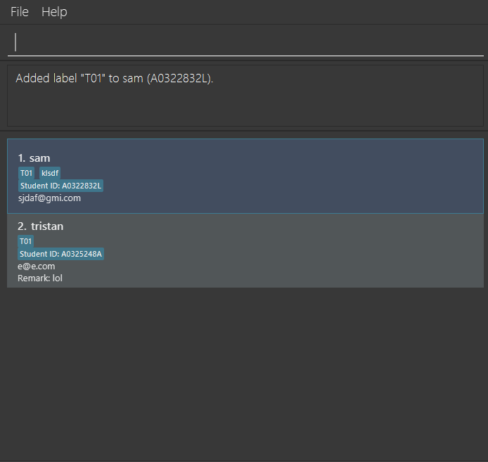

# TeachAssist

**TeachAssist helps Teaching Assistants manage student records, tutorial groups and follow-up notes.** It combines a keyboard-driven command-line interface with a graphical view of your students.

Use TeachAssist to add, edit and remove student records; find students by name, student ID, email, remark or group label; record remarks and attendance; and organise students with group labels. Student records are saved between sessions.

* **Get started:** Follow the [User Guide's Quick Start](UserGuide.html#quick-start).
* **Develop TeachAssist:** Read the [Developer Guide](DeveloperGuide.html).
* **Meet the team:** Visit [About Us](AboutUs.html).
* **Get the app or report an issue:** Visit the [TeachAssist repository](https://github.com/AY2627S1-CS2103T-F12-1/tp).

## Acknowledgements

TeachAssist is adapted from [AddressBook Level 3](https://se-education.org/addressbook-level3/) by the [SE-EDU initiative](https://se-education.org). See the [Developer Guide acknowledgements](DeveloperGuide.html#acknowledgements) for the libraries and tools used.
